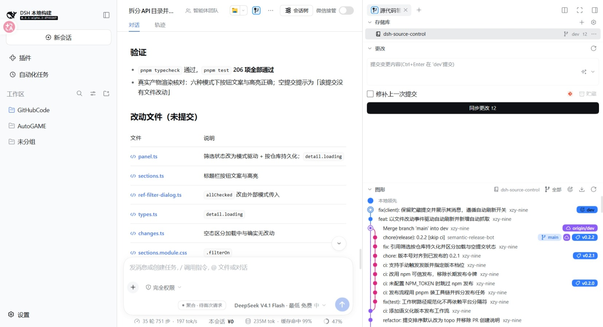
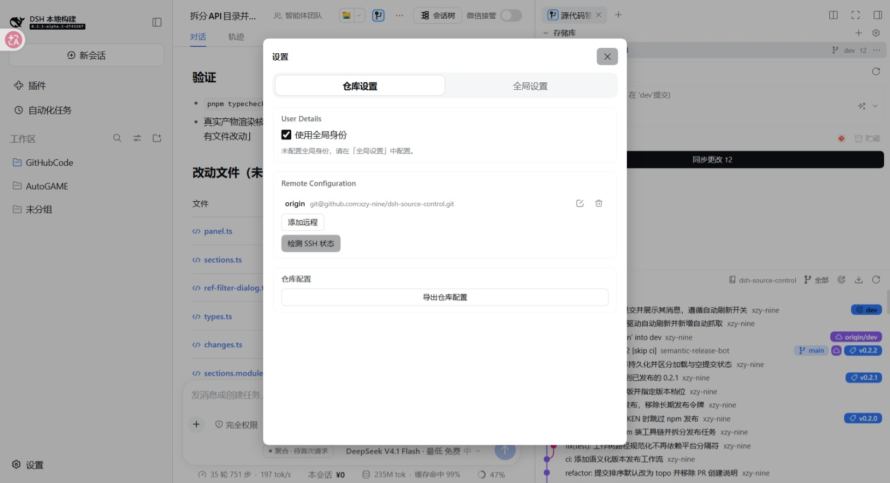

# 功能说明

本文是插件界面与操作功能的参考页。整体介绍见 [README](../../README.md)，实现内容见[代码结构](../实现/代码结构.md)。

## 页面与入口

- 页面位于 DSH Web GUI 右侧 Sidebar 的「源代码管理」页，界面控件使用 DSH 内置组件。
- 两个入口打开同一页面：右侧栏 tab 条的「+」→ 引导页里的「源代码管理」胶囊，以及会话 header 的图标按钮；页面已打开时聚焦。
- 仓库自动绑定当前会话工作区，无需手动选择。
- 切换到其他侧栏页或工作区后再回来，页面保持原状，展开状态不丢失。

页面分四个区域：存储库区列出仓库树，更改区列出工作区变更与提交框，图形区显示提交泳道图，差异页显示文件改动。各区域的完整行为见下。

## 存储库区

- 列出当前会话工作区内的仓库，并按种类用不同图标区分；仓库可展开其工作树与子模块。
- 仓库树会反映工作树、子模块与仓库自身的增删；普通提交、暂存、切换分支不会改变仓库树结构。
- 新建、克隆或删除仓库后无需手动刷新：工作区内的仓库集合变化会被自动发现。
- 每行显示所在分支与相对上游的领先 / 落后数量。
- 右键菜单：刷新、抓取、推送、复制路径。
- 对链接工作树额外提供「移除工作树」；工作树内有未提交改动时需确认强制移除。
- 对尚未检出的子模块额外提供「初始化子模块」，执行 `git submodule update --init --recursive`，可能访问远端。
- 每行的分支与检出提交只来自该行自己的仓库：子模块未检出不显示分支。
- 标题栏设置按钮左侧是克隆按钮。

克隆的完整流程见[克隆远程仓库](克隆.md)。

## 更改区

- 工作区里没有 git 仓库，或选中的子模块尚未检出时，本区与图形区换成空态：不出现提交框、变更列表与提交图，只有一句说明与一个按钮。前者在该工作区根执行 `git init`（分支名由 `init.defaultBranch` 决定，不暂存不提交），后者初始化该子模块；成功后重扫并选中新仓库。
- 工作区变更按「暂存的更改 / 更改」两个分组列出。
- 文件行显示文件类型图标、文件名与最右列状态字符；文件夹显示改动数。
- 点击文件行打开该文件；未跟踪的新文件按普通文件打开。
- 悬停出现丢弃与暂存（或取消暂存）按钮；右键菜单提供同样动作，另有打开文件与复制路径。
- 右键「打开文件」固定按整文件打开。
- 「复制路径」复制绝对路径；目标本身已是绝对路径时原样复制。
- 文件树从最早分叉的公共目录开始显示：目录逐级只有单个子目录时合并为一行。
- 条目极多时按树的深度截断：浅层整层保留，同一层按目录整块保留，更深的整层不显示；分组计数带「+」表示还有未列出的条目。改动文件列表同样如此。
- 提交框固定在顶部，只有变更列表滚动；分组头右键可全部暂存 / 取消暂存 / 丢弃。
- 未暂存的文件与文件夹右键额外提供「添加到 .gitignore」与「添加到本地排除」。
- 丢弃子模块条目时只把子模块指向的提交移回索引记录的那一个，不清理子模块内部的未提交改动；未能移动（内部改动会被覆盖）或子模块尚未初始化时，以失败弹窗说明原因，该条目保留在列表里。未跟踪的独立仓库不会被删除，改以轻量提示说明结局。

忽略规则的写法与两个入口见[忽略规则](忽略规则.md)。提交框的完整行为见[提交框](提交框.md)。

## 图形区

提交泳道图，标题栏可点击收起；标题上方的分界线是拖拽手柄，向上拖让图形变高（120–720px，持久保存）。

- 每行为「泳道 + 提交信息（作者紧随其后，空间不足时省略号截断）+ 右对齐的引用标记」。
- 引用标记：当前分支与本地分支是「图标 + 名称」药丸，远程、标签、贮藏是圆形图标，名称见悬停提示与右键菜单。远程 HEAD 不作为标记列出；被其它工作树检出的分支照常列出，但其检出、删除、重命名与「合并到该分支」在菜单里置灰并说明原因。同名的一对本地与远程分支各自成标记，签出远程分支后两者同时可见。
- 节点形状区分种类：当前分支为双同心圆、合并提交为环加内点、其余为实心点；线段停在节点外沿。
- 未提交行以虚线表示且不画节点，也不触发浮窗与右键菜单。
- 分页加载时，父提交未加载仍占住泳道并把线画到行底，已加载部分的泳道与颜色不因加载更多而改变。
- 滚动到接近底部时自动加载下一页；一页取回后若仍未填满图形区会继续取，直到无更多提交。
- **引用筛选**：标题栏的筛选入口给出「全部」「自动」与具体分支、远程分支、标签。「全部」显示所有引用；「自动」显示当前分支、它的上游与分叉来源分支（取值顺序见[性能与缓存](../实现/性能与缓存.md)）；勾选具体引用即转为手选。筛选在取数端生效，提交窗口与分页都只含所选引用的历史；手选引用被删除或改名后自动回退「自动」。筛选状态按仓库记住：关掉页面、重启后仍是上次的三种状态之一（「自动」是默认，不需要记录）。
- 悬停某行浮出卡片：作者、时间、完整提交信息、改动文件与增减行数、引用标记、短哈希与复制按钮。
- 提交信息以非当前语言为主时，时间右侧出现「翻译」按钮；译文按提交缓存，再次悬停直接显示译文。显示条件与提交框翻译入口同一判据：翻译服务可用、无进行中的翻译、内容非空且以非当前语言为主。
- 标题栏的翻译入口紧随「图形」标题文本，作用于当前可见窗口内的提交标题：点击后逐条翻译并就地替换行标题，悬停浮窗同步显示译文；译完图标反色，再点即取消并回退这一批译文（单条悬停翻译的译文保留）。翻译进行中入口不消失（图标呼吸），再点即取消；可见窗口内没有待译标题且未处于已翻译状态时该入口不出现。
- 点击某提交在该行下方就地展开改动文件区，逐文件显示 +/− 与状态；点击文件行打开差异，再次点击同一行收起。

提交行与引用标记的右键菜单见[右键菜单](右键菜单.md)。

## 差异页

在侧边栏中打开文件的差异视图，含行号列、hunk 头与代码高亮。

- 页标题给比较作用域（更改、暂存的更改、提交 <哈希>、对比 <旧> → <新>），文件名在正文首行的下拉框里。
- 一次比较只占一个页：从更改区、暂存区或提交改动块进入时，该处的同类文件都进下拉框，选中即就地切换。
- 默认左右并排、自动换行，均可切换；选择按文件记住。
- 头部显示新增与删除行数；二进制文件显示「二进制」。
- 只显示改动附近的行（按 git hunk），而不是整文件。
- 头部另有在侧边栏打开整个文件；宿主具备桌面能力时还有原生打开控件，可用默认应用打开或在文件管理器中定位。

## 打开文件

打开文件一律交宿主右侧栏按资源地址认领，由认领方渲染，本插件不指定渲染方。

- 表格 / PDF / 图片 / Office 等宿主自带渲染器的格式由宿主预览。

## 破坏性操作的确认

以下操作先弹确认框，确认按钮为红色：丢弃改动、删除本地 / 远程分支、删除标签、丢弃贮藏、重置当前分支、移除工作树、删除远程仓库配置。合并与变基也走确认框。

用本地覆盖远程（强制推送）与用远程覆盖本地（硬重置）走带勾选的强提醒弹窗：勾选「我确认」之前确认按钮禁用。详见[提交框](提交框.md)。

放弃暂存不算破坏性操作，不加确认。丢弃未跟踪文件时按「删除」措辞；丢弃子模块条目同样不算，原因见更改区。

## 操作失败的提示

失败时以标题「操作失败」的弹窗说明原因，正文可滚动并整段复制；改写仓库的操作（检出、合并、变基、重置、拣选与还原、分支与标签、贮藏、远程配置）都在其中。

- 因本地未提交改动、未跟踪文件、未完成的合并或变基、未解决的冲突、同名分支已存在而被拒绝时，提示为对应的中文说明；其他情况显示 git 的原文。
- 推送失败另有可读提示（未配置远程、无上游分支）；操作无法进行时（缺目录选择器或终端、未登录 GitHub、当前分支不可删除）同样按失败呈现。
- 已完成的结果（发布地址、Pull Request、克隆命令、忽略规则）走顶部轻量提示；需要复制正文的告知（SSH 未就绪、地址无法换算）走标题按动作给的弹窗。

## 自动刷新与提示

- 面板随文件改动、仓库写操作与定时轮询自动刷新；图形区与更改区的标题栏显示更新中状态与上次刷新时间。
- 文件改动只重取更改区：写入与编辑不改动引用与提交历史，图形区不参与这次刷新。
- 刷新取回的数据相对上一轮有变化时，顶部给出一条轻量提示，只报变化量（如「已更新：工作区 +2 个改动，提交图 +1 个提交」），不报总数。
- 只有同一仓库、同一引用筛选与同一提交窗口的相邻两轮才比较计数：换仓库、换筛选、加载更多与加载中的轮次不提示。
- 顶部轻量提示同一时刻只有一条，新的替换旧的；失败原因走弹窗，不会被更新提示盖掉。

触发机制与周期见[性能与缓存](../实现/性能与缓存.md)。

## 设置面板

设置面板分「仓库设置」「全局设置」「反馈」三个页签。

| 分区 | 内容 |
|---|---|
| General | 提交排序、日期格式、提交框与图形区的显示开关 |
| User Details | 用户身份（姓名、邮箱、位置），可写入全局或当前仓库，也可清除本地值改用全局身份 |
| Remote Configuration | 远程仓库的增删改与协议切换、SSH 状态检测 |
| Issue Linking | Issue 正则与链接模板（仅前端保存，用于识别提交信息里的 Issue 编号） |
| 仓库配置 | 导出仓库级配置为 JSON |
| AI 提交信息 | 专用供应商与模型、追加到系统提示词末尾的自定义规则 |

General 的明细：

- 提交排序：拓扑 / 时间 / 作者时间。
- 日期格式：日期和时间 / 相对 / 绝对；另有「使用 ISO 日期格式」。
- 显示开关：显示贮藏、显示标签、显示远程分支、显示作者头像、Markdown 渲染提交信息、静音合并提交。
- 加载与抓取：只跟随第一个父提交、包含 reflog 提到的提交、加载仓库后滚动到 HEAD、抓取时修剪已删除远程分支、抓取时修剪远程标签。
- 刷新与抓取：文件改动时自动刷新、自动抓取远程、自动抓取间隔（秒，10–3600；无新引用时逐轮后延，上限 30 分钟）。

远程配置与 SSH 检测见[远程与 SSH](远程与SSH.md)，AI 提交信息见[AI 提交信息](AI提交信息.md)。

## 文本日志

插件记录运行日志。反馈页可把日志随 issue 提交为评论，可选范围与分片规则见[日志与反馈](../实现/日志与反馈.md)。

## 状态保存范围

哪些状态跨会话保留、哪些只活一次挂载，分三级：窗口级、会话级与持久化。各级的载体、存活范围与失效判据见[显示与状态](../实现/显示与状态.md)。