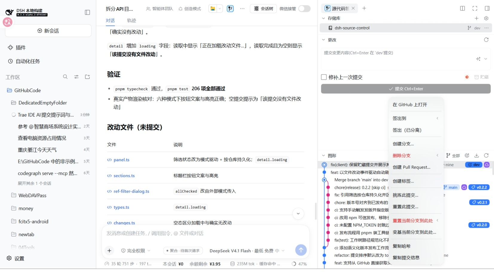

# 右键菜单

本文是提交行与引用标记右键菜单的参考页。图形区的其他行为见[功能说明](功能说明.md)。

## 提交右键菜单

按顺序为：在 GitHub 上打开、签出到、签出（已分离）、创建分支、删除分支、创建 Pull Request、创建标签、标签操作（检出标签、从此标签创建分支、复制标签名、删除标签）、挑拣此提交、重置此提交、重置当前分支到此处、变基当前分支到此处、合并到分支、复制哈希、复制提交信息。

「创建归档」只作用于分支与标签引用，不在提交行右键出现。

- **在 GitHub 上打开**：该提交已被某个 GitHub 远程的远程分支包含时出现；本地独有的提交不显示。
- **签出到**：二级菜单列出以该提交为尖端的本地分支与远程分支，仅在分支头位置出现。选远程分支时按去掉远程名的短名检出，本地没有同名分支则由 git 新建跟踪分支并设置上游。
- **签出（已分离）**：以分离头指针检出该提交。
- **创建分支**：以该提交为起点创建并检出分支。
- **删除分支**：二级菜单列出包含该提交的本地与远程分支。当前分支照常列出，点击后说明原因；被其它工作树检出的分支同样列出，但置灰并说明原因。
- **创建 Pull Request**：分支级操作，当前分支已推送到 GitHub 远程时出现，作用于当前分支。
- **创建标签**：输入标签名后创建；仓库有远程时一并推送到远程（多个远程时先选一个），没有远程时只创建本地标签。
- **标签操作**：检出标签、从此标签创建分支、复制标签名、删除标签（可同时删除远程标签）；没有标签时不显示。
- **挑拣此提交 / 重置此提交**：在当前分支上生成挑拣或还原提交。
- **重置当前分支到此处**：软重置、混合重置与硬重置三档，硬重置先确认。
- **变基当前分支到此处**：把当前分支变基到该提交；交互式变基在当前版本不受支持。
- **合并到分支**：检出选中的分支尖端并把当前分支合并过去，停在未提交状态；冲突时保持待合并状态并提示。
- 有二级菜单的项右侧带箭头标识。

## 引用标记右键菜单

按引用类型给出：

| 类型 | 菜单项 |
|---|---|
| 本地分支 | 检出此分支、从此分支创建新分支、重命名分支、合并到选中分支、变基当前分支到此处、删除分支、创建 Pull Request、复制分支名、创建归档 |
| 远程分支 | 检出远程分支（新建本地跟踪分支）、从远程分支创建本地分支、合并到当前分支、变基当前分支到此处、删除远程分支、复制远程分支名 |
| 标签 | 检出此标签、从此标签创建分支、复制标签名、删除标签、创建归档 |
| 贮藏 | 应用贮藏、弹出贮藏、从贮藏创建分支、丢弃贮藏、复制选择器 |

- 贮藏行的右键走引用菜单，不套提交浮窗。
- 分支操作与提交菜单共用同一份注册表：引用菜单按 `refTypes` 过滤，提交菜单另行给出顺序。
