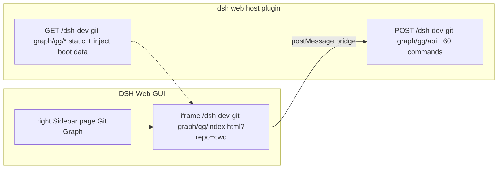

# dsh-dev-git-graph

It automatically binds to the **current session's workspace** and renders the commit graph (branch lanes, commit messages, dates, authors, refs), with the full set of git operations from the original extension available via right-click: checkout, merge, rebase, push/pull, tag, stash, and more.

[中文文档](README.zh.md)

## Features

- **Right Sidebar page**: a `devGitGraph` page type in the built-in right Sidebar; no third-party sidebar plugin required.
- **Auto-bound repo**: the graph is loaded for the session's working directory; no manual repo selection needed.
- **Full git operations**: checkout, cherry-pick, revert, merge, rebase, push, fetch, tag, stash — driven by the original extension's ~60 commands, executed directly against your local git.
- **Theming**: maps DSH design tokens (`--dsw-alias-*`) onto the graph UI; follows the host's light / dark mode.
- **No external processes**: the host runs `git` directly via `child_process.spawn` (array args, no shell injection) and serves the frontend same-origin.

## Install

```sh
dsh plugin --profile web add dsh-dev-git-graph
# restart `dsh web`, then open any conversation — the session header shows a Git Graph icon
```

### Entry points

| Entry | Seat | Behaviour |
|---|---|---|
| Guide entry capsule | the type's `guide` entry | Open the right Sidebar's `+` control, then pick the **Git Graph** capsule |
| Session header icon | `conversation.session.header.utilities` (order -5) | Opens the page, or focuses the open one |

Both open the same page type, registered through `ctx.sidebarRightTabs.register` (id `dsh-dev-git-graph/git-graph`, kind `devGitGraph`); the body sits in the keyed `sidebar.right.pane.tab` seat and the chip title in `sidebar.right.pane.tab.title`.

## How it works



- **API**: `POST /dsh-dev-git-graph/gg/api` mirrors the original extension's `gitGraphView.respondToMessage` command set.

| Area | Behaviour |
|---|---|
| VS Code-only commands | `openFile` / `viewDiff` / `viewDiffWithWorkingFile` / `openTerminal` / `createPullRequest` / `createArchive` return "not supported" |
| View state persistence | localStorage (the extension used workspaceState); `setGlobalViewState` etc. are ACKed |
| Repo source | auto-bound to the current session's workspace |

## Security

- Git is executed with **array arguments** (no shell), so repo paths / refs can't be used for shell injection.
- Static file serving sanitizes filenames against a whitelist.
- The API only acts on the repo path supplied by the host's own boot payload (the session cwd).

## Development

```sh
pnpm --filter dsh-dev-git-graph build      # build:web (tsc + pack) -> build:host (tsc) -> cp client.js
pnpm --filter dsh-dev-git-graph typecheck  # two tsconfigs: host (NodeNext) + web (DOM)
```

## License
