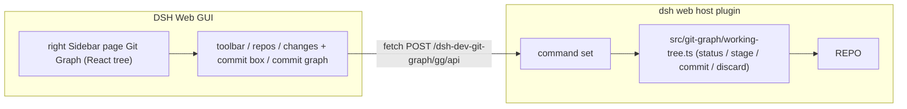

# dsh-dev-git-graph

A [DeepSeek Harness](https://github.com/DeepSeek-ai/deepseek-harness) (dsh) plugin that adds a **Git Graph page** to the DSH Web GUI's built-in right Sidebar: the commit graph, the working-tree changes list, and a commit box, arranged like VS Code's Source Control + Graph view. Its controls come from `@deepseek-ai/dsh-client-ui-primitives`, so it looks and behaves like the rest of the Harness.

It automatically binds to the **current session's workspace**; no manual repo selection is needed.

[中文文档](README.zh.md)

## Features

- **Right Sidebar page**: a `devGitGraph` page type in the built-in right Sidebar; no third-party sidebar plugin required.
- **Auto-bound repo**: the panel reads the session's working directory from the sessions snapshot; every repository row uses the local `book_2` icon, with worktrees and submodules told apart by their text label.
- **Working tree**: stage, unstage, discard, and commit, with per-file status and hover actions; the commit message reuses the DSH `InlineEditor` (Enter commits, Shift+Enter breaks the line, Escape clears the draft).
- **Commit graph**: the section header collapses on click and the divider above that header is the drag handle (dragging up grows the graph, 120–720px, saved per session); branch lanes plus one row per commit — the subject with the author beside it, then right-aligned ref markers: icon-and-name pills for the current and other local branches, and circular cloud / tag / archive badges for remotes, tags, and stashes (names in the tooltip and the context menu); remote HEAD (`refs/remotes/<remote>/HEAD`) and local HEAD are never listed as ref markers. Each row's graph column is only as wide as the lanes that row draws, so the subject sits right after it while the markers stay pinned to the row's right edge. Node shape names the kind: hollow ring for the current branch, ring with a core for merges, filled dot otherwise; lane lines stop at the node's outer edge instead of running through it. Paging only loads a window of commits, so a parent outside the window still holds its lane and keeps its line running to the row bottom — loading more never changes the lanes or colours already on screen. The date and short hash are in the row's hover card; hovering a row floats a card on the standard dsh floating surface with the author, the time (the leading label follows the configured date format and the parentheses always carry the detailed date and time, omitted when the leading label is already that detail), the full commit message, the changed-file and line counts, the ref markers (each expanded to icon plus name), and the short hash with a copy button; a hairline separates every section except the author line from the message; clicking a commit expands its changed-file region in place, directly below that row and inside the graph — the gutter continues that row's lanes on the left with the same padding and column gap as the row, the file tree collapses per folder, shows each file's +/− and status, and opens a diff, and clicking the same row again collapses it.
- **Commit context menu**: view the commit, open it on GitHub (shown only when a GitHub remote exists), check it out, create a branch or tag from it, delete a branch (a submenu lists the local and remote branches pointing at that commit), delete a tag (a submenu lists its tags), cherry-pick, revert, reset the current branch, merge, rebase, and copy the hash or the message.
- **Theming**: styles use `--dsw-alias-*` semantic tokens and follow the host's light / dark mode; ref markers use the fixed lane palette.
- **No external processes**: the host runs `git` directly via `child_process.spawn` (array args, no shell injection).

## Install

```sh
dsh plugin --profile web add dsh-dev-git-graph
# restart `dsh web`, then open any conversation — the session header shows a Git Graph icon
```

### Entry points

| Entry | Seat | Behaviour |
|---|---|---|
| Guide entry capsule | the type's `guide` entry | Open the right Sidebar's `+` control, then pick the **Git Graph** capsule |
| Session header icon | `conversation.session.header.utilities` (order -5) | Opens the page, or focuses the open one |

Both open the same page type, registered through `ctx.sidebarRightTabs.register` (id `dsh-dev-git-graph/git-graph`, kind `devGitGraph`); the body sits in the keyed `sidebar.right.pane.tab` seat and the chip title in `sidebar.right.pane.tab.title`.

## How it works



- **Frontend**: React components under `src/client/`, bundled by esbuild into `lib/client.js`. `react` and
  `@deepseek-ai/dsh-client-ui-primitives` are shell-shared platform modules and stay external.
- **Lanes**: `src/client/lanes.js` is a pure function (commit list → per-row lanes and links) rendered to SVG
  by React; it does not touch the DOM and is unit-tested.
- **API**: `POST /dsh-dev-git-graph/gg/api` keeps the ported command set and adds the working-tree commands.

### Host commands added for the changes panel

| Command | Purpose |
|---|---|
| `loadWorkingTree` | Working-tree changes (parses `git status --porcelain -z`, including rename origins) |
| `stagePaths` | Stage the given paths; an empty array stages everything |
| `unstagePaths` | Unstage; falls back to `git rm --cached` while the repo has no HEAD |
| `discardPaths` | Discard changes (`git clean` for untracked files, `git restore` for tracked ones) |
| `commitStaged` | Commit the index and return the new hash |

| Area | Behaviour |
|---|---|
| UI | No embedded VS Code webview; a React panel built from DSH primitives |
| VS Code-only commands | `openFile` / `viewDiff` / `viewDiffWithWorkingFile` / `openTerminal` / `createPullRequest` / `createArchive` return "not supported" |
| Repo source | auto-bound to the current session's workspace |

## Security

- Git is executed with **array arguments** (no shell), so repo paths and refs cannot be used for shell injection.
- The API acts only on the repo path supplied by the caller (the session workspace); no path from the browser is
  used to reach outside it.

## Development

```sh
pnpm install                               # pnpm workspace, single package
pnpm build                                 # build:host (tsc) + build:client (esbuild)
pnpm typecheck                             # host (NodeNext)
pnpm test                                  # lane layout unit tests
```

- The package manager is pnpm; `pnpm-workspace.yaml` allows esbuild's install script and
  `pnpm-lock.yaml` is committed.
- The host half compiles to `lib/` with `tsc -p tsconfig.json`; the browser half is bundled into
  `lib/client.js` by `scripts/build-client.mjs`. `prepare` runs the full build after install.
- `assets/icons/` holds the ref-marker SVGs; the client build inlines them as text, so the browser half
  requests no extra resources at runtime.
- The browser half must not import bare modules other than the shell-shared `react` and
  `@deepseek-ai/dsh-client-ui-primitives`.

## License
