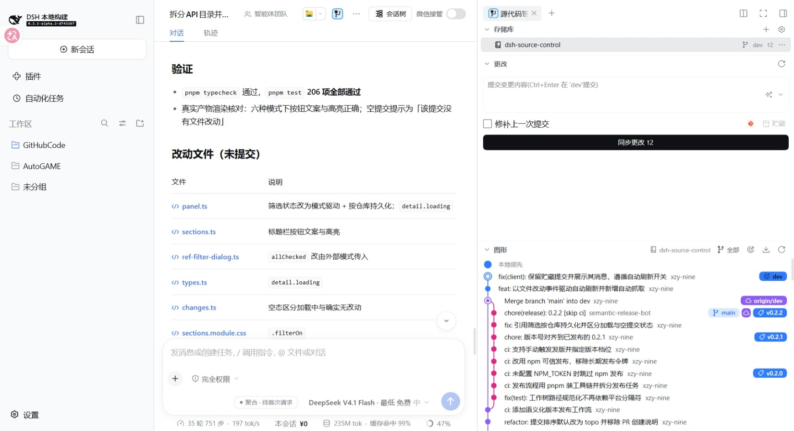
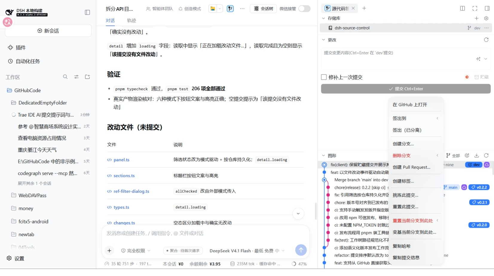
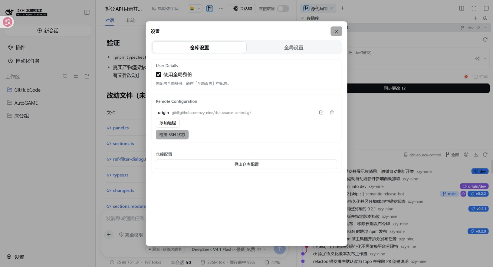

# 功能描述

本文描述插件的界面与操作功能。整体介绍见 [README](../README.md)，实现与构建约定见 [AGENTS.md](../AGENTS.md)。

## 页面与入口

- 页面位于 DSH Web GUI 右侧 Sidebar 的「源代码管理」页，界面控件使用 DSH 内置组件。
- 两个入口打开同一页面：右侧栏 tab 条的「+」→ 引导页里的「源代码管理」胶囊，以及会话 header 的图标按钮；页面已打开时聚焦。
- 仓库自动绑定当前会话工作区，无需手动选择。
- 切换到其他侧栏页或工作区后再回来，页面保持原状，展开状态不丢失。

## 存储库区

- 列出当前会话工作区内的仓库，并按种类用不同图标区分；仓库可展开其工作树与子模块。
- 仓库树会反映工作树与子模块的增删；普通提交、暂存、切换分支不会改变仓库树结构。
- 每行显示所在分支与相对上游的领先 / 落后数量。
- 右键菜单：刷新、抓取、推送、复制路径。
- 对链接工作树额外提供「移除工作树」；工作树内有未提交改动时需确认强制移除。
- 对尚未检出的子模块额外提供「初始化子模块」，执行 `git submodule update --init --recursive`，可能访问远端。
- 标题栏设置按钮左侧是克隆按钮。

### 克隆远程仓库

1. 点标题栏加号，填写远程地址：HTTPS、`ssh://`、`git@host:owner/repo.git` 与本地路径都接受。
2. 确认后拉起 DSH 目录选择器，选定父目录。
3. 打开 DSH 终端页，在其中执行 `git -C "<父目录>" clone -- "<地址>"`。克隆由终端完成，进度、凭据与 SSH 交互都在终端里。
4. 克隆不由插件执行，插件不读取克隆结果，也不判断成功与否。
5. 地址或目录含双引号、`$`、反引号、单引号或换行时，提示手动执行；界面未装载目录选择器或终端时说明原因。
6. 可选**浅克隆**：勾选后填深度（默认 1），命令追加 `--depth=<N> --single-branch --no-tags`。
   `--no-tags` 一并关掉标签跟随，否则浅克隆仍会拉取指向截断范围之外的标签。深度按正整数处理，
   非数值或 0 按完整克隆。

## 更改区

- 工作区变更按「暂存的更改 / 更改」两个分组列出。
- 文件行显示文件类型图标、文件名与最右列状态字符；文件夹显示改动数。
- 点击文件行打开该文件；未跟踪的新文件按普通文件打开。
- 悬停出现丢弃与暂存（或取消暂存）按钮；右键菜单提供同样动作，另有打开文件与复制路径。
- 右键「打开文件」固定按整文件打开。
- 「复制路径」复制绝对路径；目标本身已是绝对路径时原样复制。
- 文件树从最早分叉的公共目录开始显示：目录逐级只有单个子目录时合并为一行。
- 提交框固定在顶部，只有变更列表滚动；分组头右键可全部暂存 / 取消暂存 / 丢弃。
- 未暂存的文件与文件夹右键额外提供「添加到 .gitignore」与「添加到本地排除」。

## 忽略规则

未暂存的文件或文件夹可右键加入忽略规则。规则写法一致：`/` 锚定到忽略文件所在目录，目录带尾斜杠；同一规则已存在时不重复写入。

- **添加到 .gitignore**：规则写进最近的 `.gitignore`；都没有时在仓库根新建 `.gitignore`。子模块与链接工作树以自身为仓库根，向上搜索不越过它。写入后打开该 `.gitignore`：已被版本控制时打开差异视图，新建未跟踪时按普通文件打开。
- **添加到本地排除**：规则写进当前仓库的 `.git/info/exclude`，只在本机生效，不进版本库。

当前工作树的本地排除有内容时，提交框的储藏 / 翻译按钮左侧出现「本地排除」按钮，点击直接打开该排除文件；该文件以绝对路径按普通文件打开。

## 提交框

- 提交信息支持 Enter 提交、Shift+Enter 换行、Esc 清空草稿。
- 「修补上一次提交」勾选后提交为 `--amend`。勾选期间提交按钮始终可用（只要有提交信息），因此可以在没有暂存改动时只改提交信息；「同步」「发布」在勾选期间让位给提交按钮。
- 提交按钮显示已暂存的文件数量。
- 提交信息可由 AI 生成。
- **githook**：仓库存在可执行的提交钩子（`pre-commit` / `prepare-commit-msg` / `commit-msg`）或推送
  钩子（`pre-push`）时，提交框左侧出现该勾选项，紧跟在「修补上一次提交」之后，默认勾选。
  它同时决定提交与推送：取消勾选即本次提交、同步或发布追加 `--no-verify` 跳过钩子；取消状态是
  临时的，提交或推送完成后与切换仓库时都恢复为勾选，不持久化。位置固定在这里，不随主按钮在
  提交、同步、发布之间切换而移动。
- 提交框右侧的入口（本地排除、翻译、取消合并）各自在条件成立时才出现，按出现顺序从左往右排列，
  不占固定位置；贮藏始终固定在这排最右端。
- 钩子目录按 git 的规则判定：配置了 `core.hooksPath` 时用它的值（相对路径按仓库根解析），
  否则用 git 公共目录下的 `hooks`；链接工作树与子模块共用公共目录下的钩子。Windows 上没有
  执行位概念，钩子文件存在即视为可执行。

### 弹窗里的输入

- 单行输入框：回车即确认，与点确认按钮同义。
- 多行文本域：回车确认，Shift+回车插入换行。
- Esc 或点关闭 / 取消不产生结果。

## 图形区

提交泳道图，标题栏可点击收起；标题上方的分界线是拖拽手柄，向上拖让图形变高（120–720px，持久保存）。

- 每行为「泳道 + 提交信息（作者紧随其后，空间不足时省略号截断）+ 右对齐的引用标记」。
- 引用标记：当前分支与本地分支是「图标 + 名称」药丸，远程、标签、贮藏是圆形图标，名称见悬停提示与右键菜单。远程 HEAD 不作为标记列出；被其它工作树检出的分支照常列出，但其检出、删除、重命名与「合并到该分支」在菜单里置灰并说明原因。同名的一对本地与远程分支各自成标记，签出远程分支后两者同时可见。
- 节点形状区分种类：当前分支为双同心圆、合并提交为环加内点、其余为实心点；线段停在节点外沿。
- 未提交行以虚线表示且不画节点，也不触发浮窗与右键菜单。
- 分页加载时，父提交未加载仍占住泳道并把线画到行底，已加载部分的泳道与颜色不因加载更多而改变。
- 滚动到接近底部时自动加载下一页；一页取回后若仍未填满图形区会继续取，直到无更多提交。
- 悬停某行浮出卡片：作者、时间、完整提交信息、改动文件与增减行数、引用标记、短哈希与复制按钮。
- 提交信息以非当前语言为主时，时间右侧出现「翻译」按钮；译文按提交缓存，再次悬停直接显示译文。显示条件与提交框翻译入口同一判据：翻译服务可用、无进行中的翻译、内容非空且以非当前语言为主。
- 标题栏的翻译入口紧随「图形」标题文本，作用于当前可见窗口内的提交标题：点击后逐条翻译并就地替换行标题，悬停浮窗标题同步显示译文；译完图标反色，再点即取消，取消会回退这一批译文，单条悬停翻译的译文保留。翻译进行中入口不消失（图标呼吸），此时再点即取消；可见窗口内没有待译标题且未处于已翻译状态时该入口不出现。
- 点击某提交在该行下方就地展开改动文件区，逐文件显示 +/− 与状态；点击文件行打开差异，再次点击同一行收起。

### 提交右键菜单

按顺序为：在 GitHub 上打开、签出到、签出（已分离）、创建分支、删除分支、创建 Pull Request、创建标签、标签操作（检出标签、从此标签创建分支、复制标签名、删除标签）、挑拣此提交、重置此提交、重置当前分支到此处、变基当前分支到此处、合并到分支、复制哈希、复制提交信息。

「创建归档」只作用于分支与标签引用，不在提交行右键出现。

- **在 GitHub 上打开**：该提交已被某个 GitHub 远程的远程分支包含时出现；本地独有的提交不显示。
- **签出到**：二级菜单列出以该提交为尖端的本地分支与远程分支，仅在分支头位置出现。选远程分支时按去掉远程名的短名检出，本地没有同名分支则由 git 新建跟踪分支并设置上游。
- **签出（已分离）**：以分离头指针检出该提交。
- **创建分支**：以该提交为起点创建并检出分支。
- **删除分支**：二级菜单列出包含该提交的本地与远程分支。当前分支照常列出，点击后说明原因；被其它工作树检出的分支同样列出，但置灰并说明原因。
- **创建 Pull Request**：分支级操作，当前分支已推送到 GitHub 远程时出现，作用于当前分支。
- **创建标签**：输入标签名后创建；仓库有远程时一并推送到远程（多个远程时先选一个），没有远程时只创建本地标签。
- **标签操作**：检出标签、从此标签创建分支、复制标签名、删除标签（可同时删除远程标签）；没有标签时不显示。
- **挑拣此提交 / 重置此提交**：在当前分支上生成挑拣或还原提交。
- **重置当前分支到此处**：软重置、混合重置与硬重置三档，硬重置先确认。
- **变基当前分支到此处**：把当前分支变基到该提交；交互式变基在当前版本不受支持。
- **合并到分支**：检出选中的分支尖端并把当前分支合并过去，停在未提交状态；冲突时保持待合并状态并提示。
- 有二级菜单的项右侧带箭头标识。

### 引用标记右键菜单

按引用类型给出：

| 类型 | 菜单项 |
|---|---|
| 本地分支 | 检出此分支、从此分支创建新分支、重命名分支、合并到选中分支、变基当前分支到此处、删除分支、创建 Pull Request、复制分支名、创建归档 |
| 远程分支 | 检出远程分支（新建本地跟踪分支）、从远程分支创建本地分支、合并到当前分支、变基当前分支到此处、删除远程分支、复制远程分支名 |
| 标签 | 检出此标签、从此标签创建分支、复制标签名、删除标签、创建归档 |
| 贮藏 | 应用贮藏、弹出贮藏、从贮藏创建分支、丢弃贮藏、复制选择器 |

- 贮藏行的右键走引用菜单，不套提交浮窗。
- 分支操作与提交菜单共用同一份注册表：引用菜单按 `refTypes` 过滤，提交菜单另行给出顺序。

## 差异页

在侧边栏中打开文件的差异视图，含行号列、hunk 头与代码高亮。

- 默认左右并排，可切换为统一视图。
- 默认自动换行，可切换为不换行。
- 只显示改动附近的行（按 git hunk），而不是整文件。
- 装了 dsh-better-sidebar 且其差异页类型已启用时，差异交给该插件的差异页打开；不可用或不适用时，回退到本插件自己的差异页。两种页的差异内容与开关一致。
- 提交类差异在 better-sidebar 中显示该提交的整份补丁，不是单文件差异，页标题按此给出「短哈希 提交标题」。

## 打开文件

打开文件一律交宿主右侧栏按资源地址认领，由认领方渲染，本插件不指定渲染方。

- 装了 dsh-better-sidebar 时由它的文件编辑器认领，带编辑与保存能力；未安装或文件编辑器被关闭时，回退到 DSH 原生的文档预览。
- 表格 / PDF / 图片 / Office 等宿主自带渲染器的格式仍由宿主预览。

## GitHub 集成

通过 `gh` CLI 完成，插件内不保存令牌，沿用 `gh` 自己的登录凭据。

- **发布到 GitHub**：仓库还没有远程时，「发布」对话框提供 GitHub 页与手工页。GitHub 页可新建仓库并推送，可选公开 / 私有、个人账号或其组织、HTTPS / SSH 协议与仓库简介；手工页填写已有远程地址。
- **创建 Pull Request**：在当前分支的提交右键菜单或本地分支引用右键菜单选择「创建 Pull Request…」，填写目标分支、标题与正文，可创建为草稿。入口在存在 GitHub 远程且当前分支已推送到远程时出现。
- **权限不足时降级**：未安装 `gh`、未登录、token 缺少所需 scope 时，GitHub 入口隐藏或提示所需 scope 与补授权命令；发布仍可改用手工输入远程地址完成。
- **远程地址形态**：`https://github.com/owner/repo.git`、`git@github.com:owner/repo.git` 与 `ssh://git@github.com/owner/repo.git` 三种写法都识别，协议切换后 GitHub 入口照常可用。

## 远程配置与 SSH

设置面板的 Remote Configuration 分区管理远程仓库：

- 列出已有远程（名称、地址、编辑、删除），表单可添加或编辑名称、URL、协议与推送 URL。
- 地址输入接受 `git@host:owner/repo.git` 与 `ssh://` 写法。
- 「协议」分段控件在 HTTPS 与 SSH 之间切换时就地改写输入框内容；推送 URL 与抓取 URL 同主机时一并换算。改写只在表单内发生：点远程行的笔图标进入编辑，切换协议并保存后写入仓库配置。
- 切换到 SSH 前先检测本地 SSH 状态；切回 HTTPS 不依赖本地 SSH。
- 分区内另有「检测 SSH 状态」按钮，可重新探测，并在下方给出版本、私钥与认证结果。

### SSH 状态检测

- 检测内容：`ssh` 客户端是否可用与版本、`~/.ssh` 下的私钥、目标主机是否接受本机公钥。
- 探测非交互并带连接超时，且不写入 `known_hosts`；主机指纹未确认时给出确认指引。
- 未就绪时说明原因（未安装客户端、指纹未确认、公钥被拒、网络不可达）且不改写远程配置。

## 破坏性操作的确认

以下操作先弹确认框，确认按钮为红色：丢弃改动、删除本地 / 远程分支、删除标签、丢弃贮藏、重置当前分支、移除工作树、删除远程仓库配置。合并与变基也走确认框。

放弃暂存不算破坏性操作，不加确认。丢弃未跟踪文件时按「删除」措辞。

## 操作失败的提示

检出与切换分支、签出提交、合并、变基、重置、挑拣与还原、分支与标签的增删改、贮藏操作、远程配置与用户身份的写入，失败时都在面板上以提示条说明原因。

- 因本地未提交改动、未跟踪文件、未完成的合并或变基、未解决的冲突、同名分支已存在而被拒绝时，提示为对应的中文说明。
- 其他情况显示 git 的原文。
- 推送失败时另有可读提示：未配置远程、当前分支没有上游分支。

## 设置面板

设置面板分「仓库设置」与「全局设置」两个范围。

| 分区 | 内容 |
|---|---|
| General | 提交排序、日期格式、提交框与图形区的显示开关 |
| User Details | 用户身份（姓名、邮箱、位置），可写入全局或当前仓库，也可清除本地值改用全局身份 |
| Remote Configuration | 远程仓库的增删改与协议切换、SSH 状态检测 |
| Issue Linking | Issue 正则与链接模板（仅前端保存，用于识别提交信息里的 Issue 编号） |
| 仓库配置 | 导出仓库级配置为 JSON |
| AI 提交信息 | 专用供应商与模型、追加到系统提示词末尾的自定义规则 |

General 的明细：

- 提交排序：拓扑 / 时间 / 作者时间。
- 日期格式：日期和时间 / 相对 / 绝对；另有「使用 ISO 日期格式」。
- 显示开关：显示贮藏、显示标签、显示远程分支、显示作者头像、Markdown 渲染提交信息、静音合并提交。
- 加载与抓取：只跟随第一个父提交、包含 reflog 提到的提交、加载仓库后滚动到 HEAD、抓取时修剪已删除远程分支、抓取时修剪远程标签。
- 刷新与抓取：文件改动时自动刷新、自动抓取远程、自动抓取间隔（秒，10–3600）。

## AI 提交信息

选择供应商与模型（未配置时回退到当前会话模型），可填写追加到系统提示词末尾的自定义规则；生成时把工作区差异交给所选模型，流式返回并填入提交框。

勾选「修补上一次提交」后，差异改为「上一次提交的改动 + 本次改动」，提示词同时说明这是修补提交。

## 状态保存范围

| 级别 | 保存内容 |
|---|---|
| 窗口级 | 瞬时交互与派生数据：分组折叠、过滤弹窗、`amend`、加载上限、分页与请求中标志 |
| 会话级 | 与具体仓库绑定、重填成本高的输入：提交信息草稿（按仓库根各存一份，关标签页即清） |
| 持久化 | 用户偏好与布局：设置项、分区高度与展开态、仓库树的展开与选中、引用筛选、仓库位置缓存 |